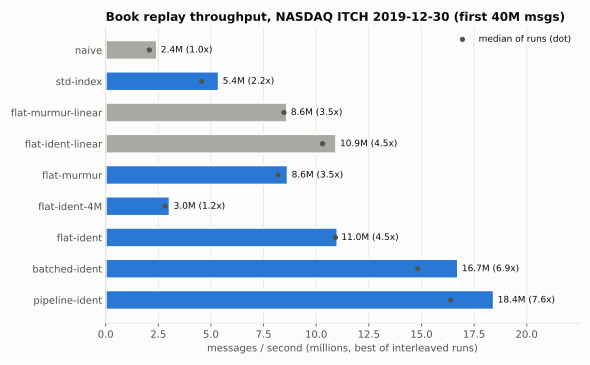
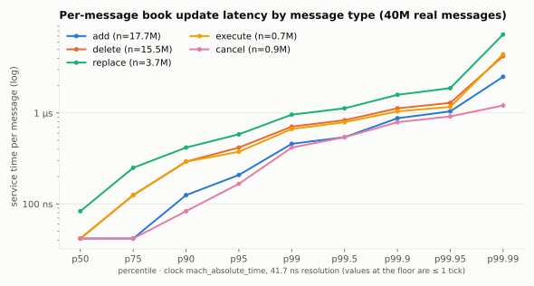
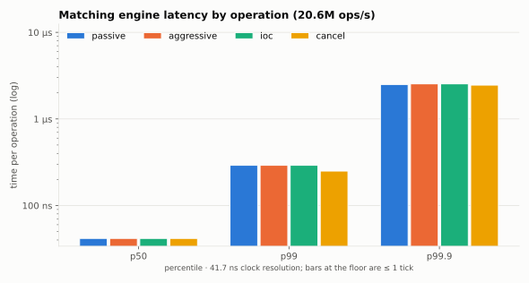

# Ironbook

**A limit order book and matching engine in C++20 that reconstructs every order book on NASDAQ
from a full day of real TotalView-ITCH 5.0 data: 268.7 million messages across 8,906 symbols in
16.5 seconds.**

Ironbook parses the raw binary feed, rebuilds every symbol's book with price-time priority,
checks the reconstruction against the feed's own execution messages, and runs a matching engine
for synthetic orders on the same data structures. The README reports two kinds of numbers:
measured results on real data, and how they were measured, including the results that didn't pan
out.

| | |
|---|---|
| Full-day replay (2019-12-30, 8.25 GB, streamed from disk) | **268.7M messages in 16.5 s, 16.3M msg/s** (two-thread pipeline) |
| Book-update throughput (40M-message RAM-resident corpus) | **18.4M msg/s**, 7.6x the `std::map`/`std::list` baseline |
| ITCH decode alone | **160M msg/s** (6.2 ns/msg) |
| Per-message book update latency | p50 ≤ 42 ns · p99 667 ns · p99.9 1.1 µs |
| Matching engine (limit, market, IOC, FOK, post-only, cancel, amend) | **48M ops/s**, 2.3x a `std::map` reference engine |
| Reconstruction errors over the full day | **0** unknown orders, 0 overfills; 100% of executions at the best price |
| Naive vs. optimized differential, full day | 0 mismatches in 264.5M top-of-book comparisons and 115,580 full-book digests |
| Tests | 104 GoogleTest cases, clean under ASan+UBSan and TSan |



*Each bar adds one optimization; gray bars are baselines and superseded variants. Measured as the
best of 5 interleaved runs. The full table and the story behind each step are in
[docs/OPTIMIZATION_LOG.md](docs/OPTIMIZATION_LOG.md).*

---

## What's inside

| Component | Highlights |
|---|---|
| **ITCH 5.0 parser** (`itch/parser.hpp`) | All 23 message types. Zero-copy over `mmap` or streaming zlib for `.gz`. Big-endian fields decoded with unaligned `memcpy` + `bswap`. Handlers bound at compile time: a handler implements `on(const X&)` only for the messages it cares about, and the rest compile away. Robust to unknown and truncated frames. |
| **Order book** (`book/order_book.hpp`, `book/market.hpp`) | 32-byte `Order`/`Level` PODs in index-addressed pools (one `mmap` reservation, LIFO free list, no `malloc` on the hot path). Intrusive FIFO queues linked with 32-bit handles. A sorted structure-of-arrays price ladder with the best price at the back, searched with a vectorized block scan. O(1) cancel, delete, and execute. |
| **Order-id index** (`book/flat_hash_map.hpp`) | Open addressing with **Robin Hood** probing and backward-shift deletion; probe distances live in what would be padding. Pluggable hash policies; identity hashing exploits NASDAQ's sequential order refs. Diagnostics for probe length and cluster size. |
| **SPSC ring buffer** (`concurrency/spsc_queue.hpp`) | Lock-free, acquire/release only. Cached peer indices, 128-byte padding against false sharing, and zero-copy batch `reserve`/`commit` and `peek`/`release`. 323M items/s. |
| **Pipeline** (`pipeline/`) | Parser thread → normalized 32-byte events → book thread, with staged software prefetch of index slot → order → level → book → ladder. Also available single-threaded as `batched_replay`. |
| **Matching engine** (`engine/matching_engine.hpp`) | Price-time priority. Limit, Market, IOC, FOK, Post-Only. Cancel; amend that keeps priority on size-down and does cancel-replace on reprice. Self-trade prevention (cancel resting or cancel incoming). Events go to a statically bound listener. |
| **Validation** (`book/validation.hpp`) | Uses the feed's own executions as ground truth: referential integrity, price priority, FIFO priority, crossed-book detection, and a per-symbol trade tape (volume, VWAP, high, low). |
| **Measurement** | `ib_bench` replay harness, `engine_sim`, Google Benchmark micro-benchmarks, an HDR-style log-linear latency histogram, a cycle-counter clock, and a built-in **SIGPROF sampling profiler** with DWARF inline symbolization that feeds flamegraphs. |

Architecture diagram, memory layout, and correctness strategy:
**[docs/ARCHITECTURE.md](docs/ARCHITECTURE.md)**.

```
mmap'd ITCH ─► parse/decode ─► 32-B BookEvent ─► [SPSC ring] ─► staged prefetch ─► FeedHandler ─► Market
 (parser thread)                                                  (book thread)        │            ├ FlatHashMap  ref → handle
                                                                                       └► Validator ├ IndexPool<Order>, IndexPool<Level>
                                                                                                    └ OrderBook[locate] → PriceLadder ×2
```

## Correctness: the reconstructed books match the feed

ITCH never sends the book itself, only deltas, so the reconstruction is checked against the
feed's own execution messages. These are the full-day results from
`itch_replay data/12302019.NASDAQ_ITCH50 --validate`:

```
feed: adds=118631456 exec=5722824 exec_px=99917 cancel=2787676 delete=114360997 replace=21639067
integrity: unknown_order=0 duplicate_add=0 overfill=0
live orders at end: 0 (peak 1,923,856)
  continuous 'E' executions checked     : 5683178
    at best price level                 : 5683178 (100.0000%)
    at head of FIFO queue               : 5672613 (99.8141%)
  crossed-book checks (continuous)      : 136896897, crossed 10 (0.00001%), locked 0
```

- **Integrity:** every one of the 145M execute, cancel, delete, and replace messages refers to an
  order the book holds, none over-executes, and the book is empty at the close.
- **Price priority:** 100% of continuous-session executions hit the best price level.
- **Time priority:** 99.81% hit the head of the FIFO queue. The other 0.19% are not explained by
  replaces (0% of them come from a `U` message), but the skipped head is an odd lot 1.8x more
  often than base rate. That is consistent with order-type constraints ITCH doesn't disclose,
  such as minimum-quantity or anti-internalization, rather than reconstruction error. See
  `FeedValidator`.
- **External check:** the reconstructed AAPL tape gives a day low of **285.23** and high of
  **292.69**. AAPL's public 2019-12-30 range is 285.22 / 292.69.
- **Differential:** `itch_replay --diff` runs the optimized `Market` and the `std::map`/`std::list`
  `NaiveMarket` in lockstep over the whole day. That's 0 mismatches in 264.5M top-of-book
  comparisons and 0 in 115,580 order-sensitive full-book digests over 23M resting orders at 14
  checkpoints.
- **Matching engine:** `MatchingEngine` and `ReferenceEngine` produce byte-identical event streams
  over 150K random operations for each self-trade-prevention mode.

## Performance

All numbers come from an Apple M5 that was shared with other heavy workloads. Variants are
therefore always run **interleaved** and reported as best and median; see the
[methodology](docs/OPTIMIZATION_LOG.md#methodology).

### Replay throughput

| corpus | mode | throughput | ns/msg |
|---|---|---:|---:|
| full day, 268.7M msgs, streamed from `mmap` | single thread | 7.75M msg/s | 129 |
| | batched + staged prefetch | 10.9M | 92 |
| | **two-thread pipeline** | **16.3M** | **61** |
| first 40M msgs, RAM-resident | naive `std::map` + `std::list` | 2.44M | 410 |
| | optimized, single thread | 11.0M | 91 |
| | batched + staged prefetch | 16.7M | 60 |
| | **two-thread pipeline** | **18.4M** | **54** |

### Latency



| message type (n) | p50 | p90 | p99 | p99.9 | p99.99 |
|---|---:|---:|---:|---:|---:|
| all (40M) | ≤ 42 ns | 250 ns | 667 ns | 1.1 µs | 3.7 µs |
| add (17.7M) | ≤ 42 ns | 125 ns | 458 ns | 875 ns | 2.5 µs |
| delete (15.5M) | ≤ 42 ns | 292 ns | 708 ns | 1.1 µs | 4.2 µs |
| replace (3.7M) | 83 ns | 417 ns | 958 ns | 1.6 µs | 7.3 µs |
| naive baseline, all | 208 ns | 833 ns | 1.9 µs | 3.2 µs | 10.5 µs |

`mach_absolute_time` ticks at 24 MHz, so values below 41.7 ns read as one tick. The means are
exact: 81.5 ns per message optimized vs. 349 ns naive.

**Producer→consumer latency vs. ring size.** The parser outruns the book by ~8x, so a full ring
just stores latency. A 256-slot ring keeps full throughput at 265x lower latency than a 64K one:

| ring slots | throughput | p50 | p99 |
|---:|---:|---:|---:|
| 65,536 | 16.8M msg/s | 3.58 ms | 12.6 ms |
| 4,096 | 18.6M | 208 µs | 475 µs |
| **256** | **17.8M** | **13.5 µs** | **35 µs** |
| 64 | 15.9M | 3.6 µs | 12 µs |

### Matching engine



10M synthetic operations around a random-walking mid (`engine_sim`): **48.2M ops/s** median,
vs. 21.0M for the reference engine, with p50 ≤ 42 ns and p99 ~290 ns per operation.
`engine_sim --seed-itch FILE --symbol AAPL --at 10:00:00` first loads the real reconstructed AAPL
book (21,027 resting orders, in exact priority order) and then trades the synthetic flow against
it.

### Component micro-benchmarks (Google Benchmark)

| benchmark | result |
|---|---:|
| ITCH decode, synthetic mixed feed | 359M msg/s · 10.5 GiB/s |
| index churn, 2M live: `std::unordered_map` / Robin Hood murmur / Robin Hood identity | 237 / 57 / **27** ns |
| index churn, 65K sequential keys: linear probing vs. Robin Hood | 52 µs vs. **5.4 ns** |
| SPSC throughput, batches of 1 / 16 / 256 | 28M / 172M / **323M** items/s |
| SPSC cross-core ping-pong round trip | 184 ns |
| `CycleClock::now()` / `LatencyHistogram::record()` | 5.5 ns / 1.75 ns |

## What made it fast, and what didn't

The full story with before/after tables is in **[docs/OPTIMIZATION_LOG.md](docs/OPTIMIZATION_LOG.md)**.
The short version:

1. **Pools, intrusive lists, and 32-byte PODs** instead of `std::map` + `std::list` + per-order
   heap nodes: **2.2–2.4x**.
2. **An open-addressing index** instead of `std::unordered_map`: **1.6x**.
3. **Identity hashing of NASDAQ's sequential order refs** turns temporal locality into spatial
   locality, **+32%**, but only at load ~0.1. At load 0.4 it collapses to **~3x slower** than
   murmur: the advancing window of new refs piles into 24,000-slot clusters. A `longest_cluster()`
   diagnostic found it.
4. **Robin Hood probing** turns the sequential-key worst case from 52 µs to 5.4 ns per op, at no
   real-data cost.
5. **Decode-ahead batching with staged software prefetch** (slot → order → level) overlaps DRAM
   misses: **+25%**.
6. **Prefetching the book and its price-ladder arrays:** **+19%**. Vectorizing the ladder search
   itself was *neutral*; the profile's "search cost" was really waiting for cache lines.
7. **A two-thread pipeline** over the SPSC ring: **+10%** on RAM-resident data and **+50%**
   end-to-end on the full day, where the parser absorbs page-cache misses.
8. **LTO and PGO: no gain.** The hot path is already fully inlined and memory-bound.

## Profiling

Flamegraphs (open the SVGs in a browser for interactive zoom):
[optimized replay](docs/flamegraphs/replay_flat_identity.svg) ·
[batched replay](docs/flamegraphs/replay_batched_identity.svg) ·
[naive replay](docs/flamegraphs/replay_naive.svg) ·
[matching engine](docs/flamegraphs/engine_sim.svg).

```bash
cmake --preset profile && cmake --build --preset profile
scripts/flamegraph_macos.sh out.svg -- ./build/profile/ib_bench data/12302019.NASDAQ_ITCH50 \
    --max 40000000 --load --mlock --mode batched --hash identity      # built-in SIGPROF sampler
scripts/flamegraph_linux.sh out.svg -- ./build/profile/ib_bench ...   # perf record + perf stat counters
```

On macOS 26, `sample(1)` cannot capture running threads without elevated privileges, and there's
no `perf`. Ironbook therefore ships its own sampler: a `SIGPROF` interval timer and an
async-signal-safe frame-pointer walk, symbolized offline with `atos -i` so inlined frames come
back from DWARF.

## Platform notes (Apple silicon)

Several measurement traps turned up along the way; details are in the
[optimization log](docs/OPTIMIZATION_LOG.md#9-measurement-pitfalls-found-along-the-way).

- **Rosetta.** CMake/Ninja from Intel Homebrew silently produced **x86-64 binaries running under
  Rosetta**. The build now detects the hardware, forces `arm64`, and resolves `-mcpu` from a
  native compiler process.
- **The `cntvct_el0` timer.** On this M5 / macOS 26 it returns a stale value for ~10⁶ consecutive
  EL0 reads; `CycleClock` uses `mach_absolute_time` (24 MHz) instead. On x86 it uses `rdtsc`.
- **Apple clang include order.** It searches `/usr/local/include` *before* `-isystem`, so fetched
  dependencies are exported as `-I`.

## Build and reproduce

Requires CMake ≥ 3.24, Ninja, a C++20 compiler (clang 15+ or GCC 12+), and zlib. GoogleTest and
Google Benchmark are fetched automatically.

```bash
cmake --preset release && cmake --build --preset release      # -O3, native CPU tuning
ctest --preset release                                         # 104 tests
cmake --preset debug   && cmake --build --preset debug   && ctest --preset debug   # ASan + UBSan
cmake --preset tsan    && cmake --build --preset tsan    && ctest --preset tsan    # ThreadSanitizer

# Data (3.5 GB download, 8.25 GB uncompressed; every tool also reads the .gz directly)
curl -o data/12302019.NASDAQ_ITCH50.gz "https://emi.nasdaq.com/ITCH/Nasdaq%20ITCH/12302019.NASDAQ_ITCH50.gz"
gunzip -k data/12302019.NASDAQ_ITCH50.gz
F=data/12302019.NASDAQ_ITCH50

./build/release/itch_stats   $F                              # message census
./build/release/itch_replay  $F --validate --tape 15         # full-day reconstruction + validation
./build/release/itch_replay  $F --diff                       # naive vs. optimized lockstep differential
./build/release/itch_replay  $F --book AAPL --at 09:30:01,10:00:00,15:59:59 --depth 10
./build/release/itch_replay  $F --pipeline                   # two-thread replay with latency sampling
./build/release/ib_bench     $F --max 40000000 --load --mlock --mode pipeline --hash identity
./build/release/engine_sim   --orders 10000000 [--seed-itch $F --symbol AAPL --at 10:00:00]
./build/release/bench/ironbook_bench                         # Google Benchmark suite

scripts/run_benchmarks.sh $F 40000000 5     # interleaved optimization ladder → bench/results/*.jsonl
scripts/pgo.sh $F                           # PGO + LTO build for comparison
python3 scripts/plot_results.py ladder bench/results/<run>.jsonl docs/img/throughput_ladder.svg
```

## Repository layout

```
include/ironbook/
  common/       types, compiler hints, big-endian loads, CycleClock, LatencyHistogram,
                MappedFile/VirtualArena, SamplingProfiler
  itch/         message structs, parser, encoder, gzip/mmap reader, symbol table, synthetic feed
  book/         NaiveMarket (baseline), IndexPool, FlatHashMap, OrderBook/PriceLadder, Market,
                FeedHandler, FeedValidator
  concurrency/  SpscQueue, thread placement
  pipeline/     BookEvent + Normalizer, batched_replay (staged prefetch), run_pipeline
  engine/       MatchingEngine, ReferenceEngine (oracle)
src/            non-template pieces (file reader, timing, histogram, profiler, symbols)
apps/           itch_stats, itch_slice, itch_replay, ib_bench, engine_sim
tests/          GoogleTest suites + real NASDAQ slices (tests/data)
bench/          Google Benchmark suite; results/ holds raw JSONL from every measurement
scripts/        benchmark runner, summarizer, plots, PGO, flamegraph tooling
docs/           ARCHITECTURE.md, OPTIMIZATION_LOG.md, flamegraphs/, img/
```

## Limitations and next steps

- Throughput is bound by DRAM latency. The index (256 MB at the identity-friendly load factor) and
  the order pool don't fit in cache. Next candidates: 8-byte packed index slots (40-bit key,
  24-bit handle) and huge pages (`MADV_HUGEPAGE` is enabled on Linux but unmeasured here).
- Per-operation latency on Apple silicon is quantized to 41.7 ns. An x86 `rdtsc` run would resolve
  the sub-tick distribution.
- The matching engine is single-threaded per instrument set, with no network or gateway layer; it
  is a matching core, not an exchange.
- `NaiveMarket` and `ReferenceEngine` are reasonable `std`-container designs, not straw men. The
  reference engine was deliberately given O(1) cancels; see pitfall 6 in the log.
